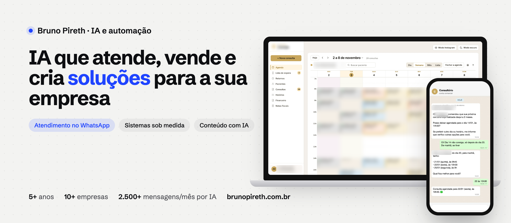

 

## Sobre mim

Sou Bruno Pireth, desenvolvedor de IA e automação em Goiânia (GO). Construo soluções para clínicas, empresas de educação, times de vendas e criadores de conteúdo: do atendimento no WhatsApp aos sistemas internos, sempre seguindo as regras da empresa e com a equipe no controle.

Não entrego um projeto e sumo. Depois que entra no ar, eu acompanho, ajusto e evoluo junto com o time.

## Projetos em destaque

**[rebot-pirethai](https://github.com/brunorosapireth/rebot-pirethai)**: app nativo para macOS que grava e reproduz mouse e teclado para automatizar tarefas repetitivas. Código público em Swift e SwiftUI.

**Aplicações por segmento**

| Segmento | O que foi feito |
| --- | --- |
| Clínica | Atendente de IA no WhatsApp que agenda, confirma e convida para retorno. |
| Academia de tênis | Agente que entende áudio e troca ou marca aulas sozinho. |
| Criador de conteúdo | Máquina de conteúdo com calendário, aprovação no celular e publicação. |
| Time de vendas | Painel de vendas com funil e metas do mês. |
| Educação | Busca dentro dos vídeos que leva ao minuto exato da resposta. |
| Site com blog | Migração para um site rápido que o Google e as IAs conseguem ler. |

<a href="https://brunopireth.com.br/#cases"><b>Ver as telas dos projetos no site →</b></a>

## O que eu faço

| Frente | O que resolve |
| --- | --- |
| **Atendimento com IA** | Responde na hora no WhatsApp e no Instagram, agenda e passa para a equipe o que precisa de gente. |
| **Sistemas sob medida** | Agenda, vendas e controles internos do jeito que a sua operação funciona, sem planilha solta. |
| **E-mail e WhatsApp em escala** | Automatiza newsletters, réguas e avisos para manter contato com a sua base. |
| **Conteúdo com IA** | Calendário editorial, aprovação e publicação para manter a frequência do conteúdo. |
| **Sites para Google e IAs** | Site que o Google e as IAs conseguem ler. |
| **Infraestrutura e segurança** | Servidor próprio, domínio protegido e limite de gasto com IA. |

## Como trabalho

| 1. Conversa e mapa | 2. Entrega | 3. Acompanhamento contínuo |
| --- | --- | --- |
| Entendo a rotina e mostro onde a IA economiza tempo ou traz venda. | Coloco a solução para funcionar, com teste antes de ir ao ar. | Acompanho os números, ajusto e evoluo junto com a equipe. |

## Números

| **5+** | **10+** | **2.500+** | **31%** |
| :---: | :---: | :---: | :---: |
| anos de experiência | empresas atendidas | mensagens por mês respondidas por IA | abertura média das newsletters (melhor edição: 49%) |

## Ferramentas

   
  

- **IA:** Claude, Claude Code, ChatGPT, Codex, Whisper, Gemini e Perplexity.
- **Canais:** WhatsApp, Instagram, Meta, YouTube, LinkedIn, ActiveCampaign e Resend.
- **Automação e gestão:** n8n, Google Planilhas, Pipedrive e Hotmart.

---

**Quer saber onde a IA ajuda na sua empresa?** 
[Falar no WhatsApp](https://wa.me/5562999996121?text=Ol%C3%A1%2C+Bruno%21+Vi+seu+GitHub+e+quero+conversar+sobre+a+minha+empresa.) · [pirethgestao@gmail.com](mailto:pirethgestao@gmail.com)

