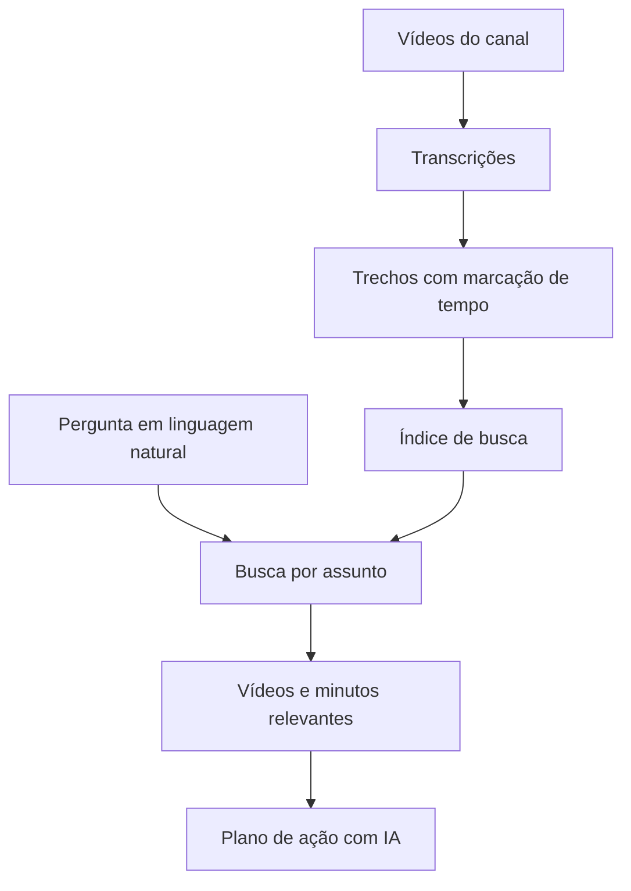

# Busca por assunto dentro de vídeos

**Segmento:** Educação e conteúdo

Pesquisa em linguagem natural que encontra o vídeo e o trecho relevante.

## O problema

Quem buscava uma resposta precisava localizar o vídeo e percorrer a gravação. A pesquisa por palavras isoladas não capturava bem a intenção de perguntas feitas em linguagem natural.

## O que construí

- Coleta e processamento de vídeos novos.
- Organização das transcrições em trechos pesquisáveis.
- Resultados com vídeo e indicação do minuto relevante.
- Plano de ação gerado por IA a partir da consulta e captação de contato.

## Decisão técnica

A qualidade da recuperação foi investigada antes de alterar o texto de instrução da IA. O índice de busca precisava devolver os trechos adequados para que a resposta fosse útil.

## Como as partes se conectam

Diagrama conceitual da solução, sem detalhes da infraestrutura privada.

Vídeo → transcrição → trechos indexados → pergunta → resultado com marcação de tempo.

## Na operação

O acervo passa a ser explorado pelo assunto que a pessoa procura, com acesso direto ao trecho.

## Ferramentas usadas

React, Supabase, PostgreSQL, YouTube e Claude.

[Ver apresentação e telas no portfólio](https://brunopireth.com.br/cases/busca-semantica-videos)

---

Este estudo apresenta o projeto por segmento. Código-fonte, dados e configurações da operação permanecem privados.

[Todos os projetos](README.md) · [Perfil](../README.md)
